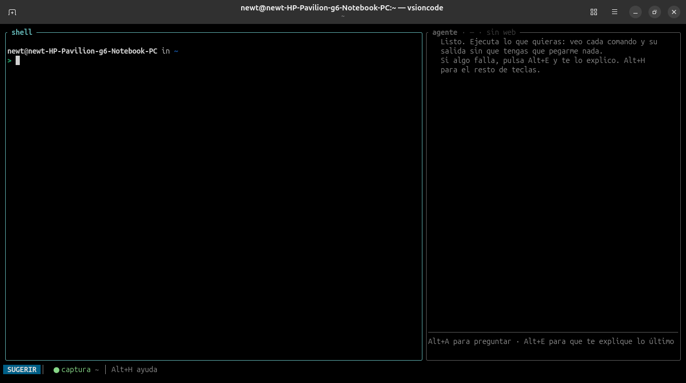
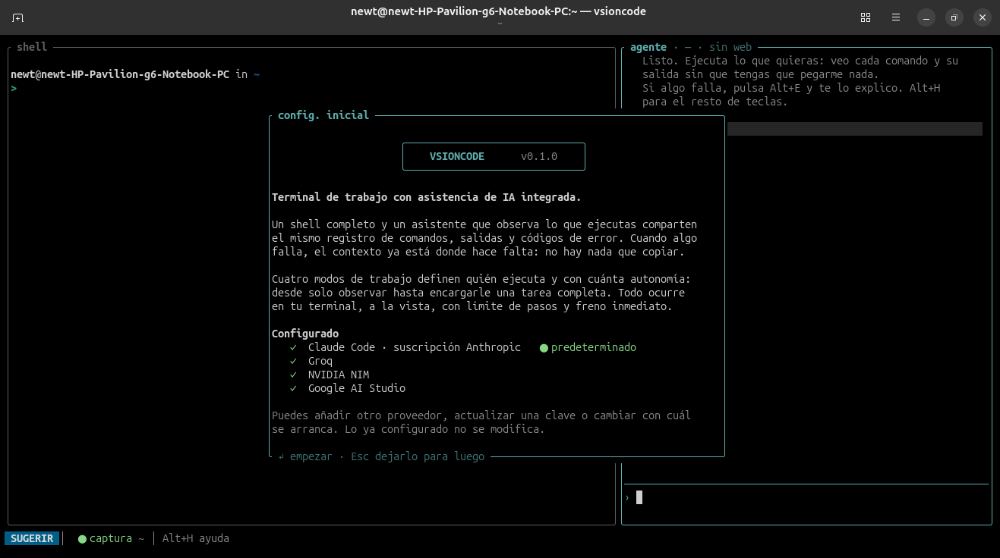
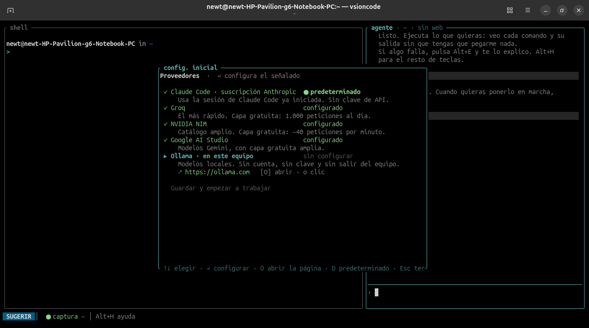
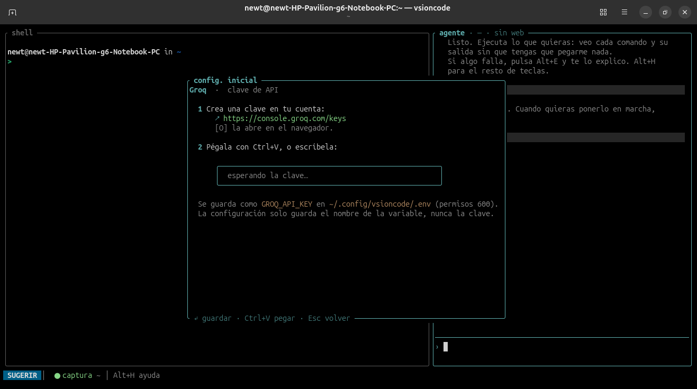
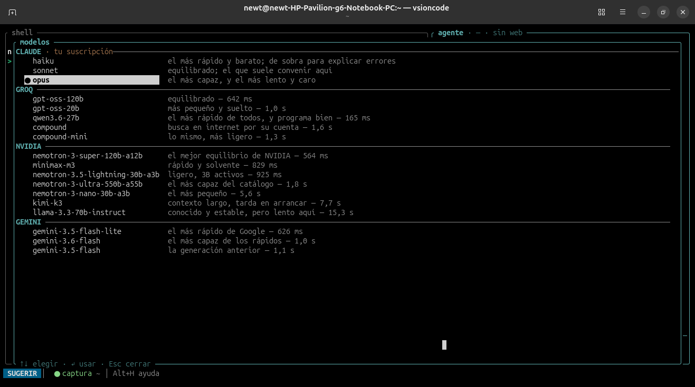
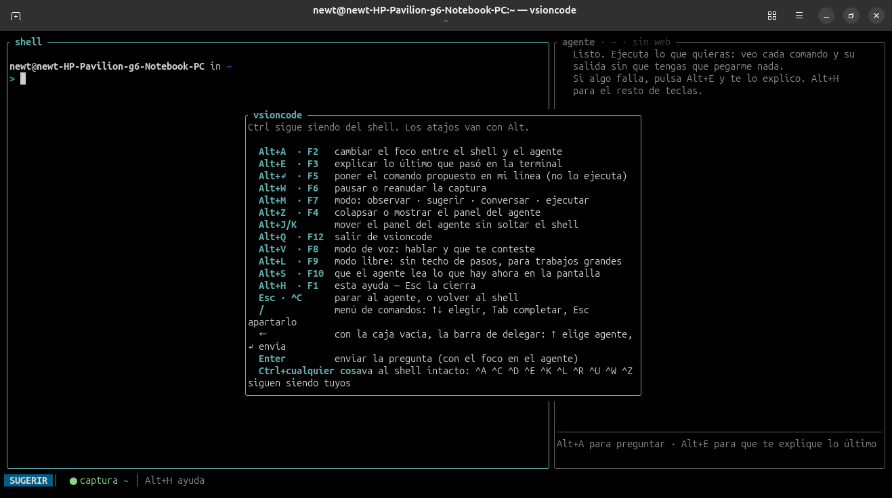

<div align="center">

# vsioncode

**Terminal de trabajo con asistencia de IA integrada.**

Un shell real y un asistente que ve lo que ejecutas, en la misma ventana.
Sin copiar. Sin pegar. Sin salir de la terminal.

[](../../actions/workflows/ci.yml)
[](#licencia)
[](https://www.rust-lang.org/)
[](#rendimiento)
[](#sistemas-compatibles)

```bash
curl -fsSL https://raw.githubusercontent.com/jchacon1808/vsioncode/main/instalar.sh | bash
```

</div>

---

## Qué es

vsioncode es una **herramienta de línea de comandos**: un emulador de terminal
que ejecuta un `bash` completo y, al lado, un panel de asistencia conectado a un
modelo de lenguaje. Las dos mitades comparten un mismo **registro de lo
ejecutado**, así que el asistente ve tus comandos y sus salidas en el momento en
que ocurren.

No es un agente autónomo ni un chatbot con una terminal dentro. Es el entorno de
trabajo: tú sigues teniendo tu shell, tu `.bashrc`, tus alias y tu prompt, y el
modelo es una pieza más del programa —opcional, sustituible y sin permisos sobre
el sistema—. Si no hay modelo disponible, vsioncode sigue siendo una terminal
que funciona.

La diferencia con las herramientas de asistencia habituales es estructural: el
modelo **no tiene herramientas para tocar tu máquina**. Redacta texto y propone
comandos; ejecutarlos es cosa tuya o de vsioncode, siempre en la terminal que
estás mirando.

## El problema que resuelve

Trabajar con un asistente mientras administras o programas significa hoy esto:

```
escribo → falla → selecciono la salida → la pego en un chat → leo →
copio el comando → lo pego de vuelta → Enter
```

Seis saltos de contexto por iteración, y un asistente que solo ve lo que le has
dado a mano. Con vsioncode:

```
escribo → falla → Alt+E → leo → Alt+↵ → Enter
```

El asistente ya tenía el comando, la salida completa, el código de salida, la
duración y el directorio. No hay nada que pegar porque nunca hubo que copiar.

## En una pantalla



A la izquierda, tu `bash`. A la derecha, el asistente. Abajo, la barra dice
siempre tres cosas: en qué modo estás, si la captura está encendida y en qué
directorio. Nada de eso se esconde ni se desvanece.

---

## Índice

| Sección | Contenido |
|---|---|
| [Instalación](#instalación) | sistemas compatibles, cuatro formas de instalar, desinstalar |
| [Primer arranque](#primer-arranque) | elegir proveedor y dejarlo listo |
| [Proveedores y suscripciones](#proveedores-y-suscripciones) | qué cuesta cada uno y cuál elegir |
| [Para qué sirve](#para-qué-sirve) | casos de uso reales, con ejemplos |
| [Guía de uso](#guía-de-uso) | teclado, ratón, modos, comandos |
| [Funcionalidades](#funcionalidades) | registro, ejecución, plan, edición, adjuntos, voz, skills, web, subagentes |
| [Configuración](#configuración) | ficheros, TOML, modelos, apariencia |
| [Seguridad](#seguridad) | el modelo de permisos y sus límites |
| [Privacidad](#privacidad) | qué se captura y qué nunca sale del equipo |
| [Rendimiento](#rendimiento) | mediciones reproducibles |
| [Arquitectura](#arquitectura) | cómo está construido |
| [Desarrollo](#desarrollo) | compilar, probar, contribuir |

---

## Instalación

### Sistemas compatibles

vsioncode es **para Linux**. No es una limitación de empaquetado: el programa
lee `/proc` para saber si un shell sigue vivo, arranca `bash` bajo un
pseudoterminal de tipo Unix y la voz usa ALSA. Decirlo claro es más útil que
prometer una portabilidad que no está probada.

| | |
|---|---|
| **Sistema** | Linux, cualquier distribución |
| **Arquitecturas** | `x86_64` y `aarch64` |
| **Requisito único** | `bash` (que ya está en toda instalación de Linux) |
| **Binario publicado** | glibc 2.35 o superior: Ubuntu 22.04+, Debian 12+, Fedora 36+, RHEL 9+, openSUSE Leap 15.5+, Arch, y derivadas |
| **Cualquier otra base** | compilar desde el código, que no impone versión de glibc |
| **Windows** | dentro de **WSL2**, que es Linux de verdad; no hay versión nativa |
| **macOS y BSD** | no soportados |

Se ha usado a diario en Ubuntu 26.04. Funciona en cualquier emulador de
terminal con UTF-8 —GNOME Terminal, Konsole, Alacritty, kitty, WezTerm, xterm,
tmux— y no necesita entorno gráfico: por `ssh` en un servidor sin escritorio
funciona igual, salvo el pegado de imágenes, que necesita Wayland o X11.

**Nada más es obligatorio.** Todo lo demás se detecta al arrancar y su ausencia
nunca es un error:

| Componente | Habilita | Si no está |
|---|---|---|
| [`claude`](https://claude.com/claude-code) en el `PATH` | asistente con tu suscripción de Anthropic | se usa otro proveedor, o ninguno |
| Clave de Groq / NVIDIA / Google / … | modelos por HTTP, con capa gratuita | se usa `claude`, o ninguno |
| [`ollama`](https://ollama.com) | modelos locales, sin cuenta ni red | ídem |
| [`uv`](https://docs.astral.sh/uv/) + `arecord` | reconocimiento de voz | el modo de voz no se ofrece |
| `piper` + `aplay` | respuesta hablada | escucha, pero no contesta en voz |
| Wayland o X11 | pegar imágenes con `Ctrl+V` | se pueden arrastrar ficheros igual |

Sin ningún proveedor configurado, vsioncode arranca como una terminal normal y
la ventana de configuración te explica qué falta. Nunca falla por lo que no
tienes.

### Cuatro formas de instalarlo

#### 1. Una orden (recomendada)

```bash
curl -fsSL https://raw.githubusercontent.com/jchacon1808/vsioncode/main/instalar.sh | bash
```

Descarga el binario de tu arquitectura desde la última publicación, comprueba su
hash `SHA-256`, lo deja en `~/.local/bin/vsioncode` y te dice qué componentes
opcionales tienes y cuáles no. No pide permisos de administrador y no toca nada
fuera de tu carpeta personal.

Si no hay binario que sirva en tu equipo —arquitectura poco común, glibc
antigua, o todavía no hay ninguna versión publicada— **te dice por qué** y
compila desde el código.

El script admite opciones:

```bash
# Para todos los usuarios del equipo
curl -fsSL .../instalar.sh | sudo bash -s -- --prefijo /usr/local/bin

# Una versión concreta
curl -fsSL .../instalar.sh | bash -s -- --version v0.1.0

# Compilar siempre, sin descargar nada
curl -fsSL .../instalar.sh | bash -s -- --fuente
```

> Canalizar un script desde internet a `bash` merece un vistazo antes. El de
> vsioncode son 278 líneas comentadas y se lee entero en dos minutos:
> [`instalar.sh`](instalar.sh).

#### 2. Con cargo, sin clonar nada

Si ya tienes Rust 1.90 o superior:

```bash
cargo install --git https://github.com/jchacon1808/vsioncode --locked
```

Es la vía más corta si vas a compilar de todas formas, y la que funciona en
cualquier arquitectura y con cualquier versión de glibc.

#### 3. Desde el código

```bash
git clone https://github.com/jchacon1808/vsioncode
cd vsioncode
cargo install --path . --locked
```

O, para probarlo sin tocar el `PATH`:

```bash
cargo build --release
./target/release/vsioncode
```

Si no tienes Rust:

```bash
curl --proto '=https' --tlsv1.2 -sSf https://sh.rustup.rs | sh
```

#### 4. El binario a mano

En [**Releases**](../../releases) hay un `.tar.gz` por arquitectura y un
`SHA256SUMS`:

```bash
V=v0.1.0
curl -fsSLO https://github.com/jchacon1808/vsioncode/releases/download/$V/vsioncode-$V-x86_64-unknown-linux-gnu.tar.gz
curl -fsSLO https://github.com/jchacon1808/vsioncode/releases/download/$V/SHA256SUMS
sha256sum -c --ignore-missing SHA256SUMS
tar xzf vsioncode-$V-x86_64-unknown-linux-gnu.tar.gz
install -m 755 vsioncode-$V-*/vsioncode ~/.local/bin/
```

Es un binario **autocontenido**: el fichero de arranque del shell y los scripts
de voz van dentro. No instala nada más y no deja rastro fuera de
`~/.config/vsioncode` y `~/.local/share/vsioncode`.

### Si el mandato no aparece

`~/.local/bin` está en el `PATH` por defecto en la mayoría de distribuciones,
pero no en todas. El instalador lo comprueba y te lo dice; para arreglarlo:

```bash
echo 'export PATH="$HOME/.local/bin:$PATH"' >> ~/.bashrc && exec bash
```

### Actualizar y desinstalar

Actualizar es volver a lanzar el instalador: sobrescribe el ejecutable y
conserva tu configuración.

```bash
# Desinstalar
curl -fsSL .../instalar.sh | bash -s -- --desinstalar

# Con cargo
cargo uninstall vsioncode
```

La configuración vive aparte y no se borra sola:

```bash
rm -rf ~/.config/vsioncode ~/.local/share/vsioncode
```

---

## Primer arranque

La primera vez que se abre en un equipo no hay configuración, así que vsioncode
muestra la ventana de **configuración inicial**: explica qué es, enumera los
servicios que puede usar y pide lo mínimo para empezar.



En un equipo recién instalado esa ventana termina pidiéndote que elijas
proveedor; en la captura ya hay cuatro configurados, que es como se ve al
reabrirla más tarde.

El segundo paso es la lista de proveedores, con el estado de cada uno y su
página de claves:



Al elegir un proveedor con clave, la pantalla siguiente separa los dos pasos —de
dónde sale la clave y dónde se pega— y dice exactamente dónde acabará guardada:



Al terminar, vsioncode escribe dos ficheros y arranca con ellos sin necesidad de
reiniciar:

- `~/.config/vsioncode/proveedores.toml` — los servicios y sus modelos. No
  contiene ninguna clave, así que puede copiarse entre equipos o mostrarse en
  una captura.
- `~/.config/vsioncode/.env` — las claves, con permisos `600`.

Si ya tienes exportada la variable correspondiente (`GROQ_API_KEY`,
`NVIDIA_API_KEY`, `GEMINI_API_KEY`), la ventana lo detecta y no vuelve a
pedírtela. `Esc` deja la configuración para más tarde.

### Añadir o cambiar un servicio después

`/configurar` —o `vsioncode --configurar`— reabre la misma ventana en cualquier
momento, y llega sabiendo lo que ya tienes: los servicios configurados aparecen
marcados con `✓` y el activo, con `● se usará al arrancar`. Desde ahí puedes:

- **añadir otro servicio** sin tocar los anteriores;
- **cambiar la clave** de uno ya configurado (por ejemplo, al rotarla), pulsando
  `↵` sobre él;
- **elegir con cuál arrancar**, con `D`.

Al guardar, el fichero existente **se fusiona, no se sobrescribe**: los bloques
que hayas escrito a mano —otro servidor, otros modelos, tus notas— se conservan
intactos.

### Opciones de arranque

```
vsioncode [opciones]

  --model <id>      modelo a usar. Por defecto se respeta el configurado en
                    ~/.claude/settings.json
  --configurar      abre la puesta en marcha: servicios, claves y modelo
  --sin-agente      arranca solo la terminal, sin asistente
  --sin-web         el asistente no podrá consultar internet
  --binario <ruta>  ejecutable del asistente (por defecto: claude)
  -h, --help        ayuda
  -V, --version     versión
```

---

## Proveedores y suscripciones

vsioncode no trae modelo propio ni cuenta propia. Habla **dos dialectos** y con
eso llega a casi todo lo que hay:

- **El proceso local `claude`**, que reutiliza la sesión de Claude Code que ya
  tengas iniciada. No hay clave de API de por medio.
- **La API de tipo OpenAI**, que hoy implementan Groq, NVIDIA, Google, Ollama,
  OpenRouter, Cerebras, DeepSeek, llama.cpp y prácticamente cualquier servicio
  nuevo.

### Qué puedes usar, y qué cuesta

| Servicio | Cómo se paga | Qué hace falta | Bueno para |
|---|---|---|---|
| **Claude Code** · suscripción Anthropic | tu plan Pro o Max ya existente; también consumo por API | tener `claude` instalado y con sesión iniciada | el trabajo serio: programar, planificar, razonar sobre un proyecto entero. Es el único que trae búsqueda web y subagentes con herramientas propias |
| **Groq** | **capa gratuita**: 30 peticiones/minuto y 1.000 al día | una clave gratis en <https://console.groq.com/keys> | el uso diario en terminal. Es el más rápido con diferencia: `qwen3.6-27b` abre la boca en 165 ms |
| **NVIDIA NIM** | **capa gratuita**: ~40 peticiones/minuto | una clave gratis en <https://build.nvidia.com> | catálogo amplio, incluidos modelos muy grandes. Duerme los modelos poco usados: la primera pregunta a uno frío tarda más |
| **Google AI Studio** | **capa gratuita** amplia | una clave gratis en <https://aistudio.google.com/apikey> | contexto largo e imágenes. Necesita el control de razonamiento activado o tarda segundos en cada turno |
| **Ollama** · en tu equipo | gratis, y sin salir de la máquina | `ollama` instalado y un modelo descargado | equipos sin red, datos que no pueden salir, o simplemente no depender de nadie |
| **Cualquier otro compatible** | lo que cobre | añadir un bloque al TOML | OpenRouter, Cerebras, DeepSeek, vLLM, llama.cpp, un servidor de tu empresa |

**No hay que elegir uno.** Se configuran los que quieras y se cambia en caliente
con `/modelo`, sin reiniciar y sin perder la conversación. Un uso habitual es
tener Groq para las preguntas del día a día —porque es instantáneo y gratis— y
la suscripción de Claude para cuando hay que pensar de verdad.

### Cómo se elige el modelo

`/modelo` abre un selector con los modelos agrupados por proveedor y el tiempo
que tarda cada uno en emitir la primera palabra, medido con este mismo cliente:



La mayoría de los modelos actuales razonan por defecto, lo que en una terminal
se traduce en segundos de pantalla quieta. Cada modelo declara en el TOML cómo
desactivarlo —`esfuerzo` o `pensar`, según la familia— y el efecto es notable:

| Modelo | Por defecto | Razonamiento desactivado |
|---|---|---|
| `qwen/qwen3.6-27b` | 972 ms | **165 ms** |
| `nvidia/nemotron-3-super-120b` | 6,5 s | **564 ms** |
| `gemini-3.6-flash` | 3,7 s | **1,0 s** |

Para esta herramienta, un modelo rápido y mediano suele ganarle a uno lento y
brillante: las respuestas son cortas y la latencia se nota más que la
profundidad. En el trabajo por plan y en el modo libre pasa lo contrario, y por
eso se cambia en un segundo.

---

## Para qué sirve

vsioncode nació para el trabajo de terminal —administrar, diagnosticar,
instalar, arreglar— y sirve igual de bien para programar. Lo que cambia entre un
uso y otro no es la herramienta: es el [modo](#modos-de-operación) en que la
pones.

### Administrar un equipo o un servidor

El caso para el que se hizo. Estás en la terminal, algo falla, y el asistente ya
tiene delante el comando, la salida entera y el código de salida.

```
$ systemctl start nginx
Job for nginx.service failed because the control process exited with error code.
$ ▊                                          ✗ 1   Alt+E explicar
```

`Alt+E` y te dice qué ha pasado —normalmente que el puerto 80 está ocupado, o
que hay una directiva mal escrita en el fichero de configuración— y te propone
el comando siguiente, que se escribe **en tu línea** con `Alt+↵`. Tú pulsas
Enter, o no.

Sirve igual para lo que se hace todos los días y nunca se recuerda entero:
permisos que no cuadran, un servicio que no arranca, un disco que se ha
llenado, un `cron` que no dispara, unidades de `systemd`, journalctl con los
filtros que nunca te sabes.

### Redes y diagnóstico

Una de las mejores aplicaciones, porque el diagnóstico de red es exactamente
«lanza esto, mira la salida, decide lo siguiente» repetido diez veces.

```
> por qué no llego a 10.0.0.5 desde aquí
```

En modo *ejecutar* el asistente encadena los comandos en tu propio shell, a la
vista: `ip route`, `ping`, `traceroute`, `ss -tulpn`, `nft list ruleset`,
`dig`, `curl -v`. Cada salida entra en el registro y la usa para decidir la
siguiente, y al terminar te dice qué encontró en dos frases en vez de dejarte
una pared de volcados.

Lo mismo con capturas de `tcpdump`, con un `nmap` sobre tu propia red, con un
certificado que caducó, con un DNS que responde otra cosa desde dentro que
desde fuera, o con una VPN que levanta la interfaz pero no la ruta.

### Instalar y actualizar paquetes

```
> necesito ffmpeg con soporte de libx265
```

El asistente reconoce tu distribución por lo que ya ha visto en la terminal,
propone el comando de tu gestor —`apt`, `dnf`, `pacman`, `zypper`, `nix`— y, si
el paquete no está en los repositorios, te dice qué alternativas hay antes de
recomendarte compilar.

Cuando una actualización rompe algo —una dependencia que entra en conflicto, un
repositorio que ya no firma, un paquete retenido, un `dpkg` a medias— el
asistente ve el error completo con su código y trabaja sobre eso, no sobre tu
resumen de lo que creías haber leído.

**Instalar software nunca se ejecuta solo**, en ningún modo. El comando se
prepara en tu línea y lo lanzas tú. Es una de las salvaguardas explícitas del
[modelo de seguridad](#seguridad): lo que cambia el sistema se mira antes.

### Errores de binarios, dependencias y arranque

El caso en que un buscador no ayuda porque el mensaje es tuyo y de nadie más:

```
$ ./mi-programa
./mi-programa: error while loading shared libraries: libssl.so.1.1: cannot open shared object file
```

`Alt+E`. El asistente ya tiene el mensaje exacto, sabe en qué directorio estás y
qué distribución usas, y te lleva por `ldd`, `ldconfig -p`, el paquete que
faltaba o la variable `LD_LIBRARY_PATH` que sobra. Igual con un `segfault` que
hay que mirar con `dmesg`, con un `exec format error` de una arquitectura
equivocada, o con un servicio que muere al arrancar y solo deja una línea en el
journal.

### Comandos de superusuario

`sudo` no equivale a peligro: administrar es trabajo normal. vsioncode
**clasifica lo que va detrás del `sudo`**, y el `sudo` en sí solo eleva un
escalón desde «seguro» para señalar que eso se ejecuta como root.

En la práctica:

- Un `sudo systemctl restart nginx` se trata como lo que es: una operación
  reversible y corriente.
- Un `sudo rm -rf /var/lib/...` se clasifica como destructivo y **nunca se
  ejecuta solo**, en ningún modo.
- Un comando que va a **esperar tu contraseña** se te devuelve a ti: lanzado por
  el asistente, el proceso se quedaría colgado pidiéndosela a nadie.

Ese último punto es una funcionalidad, no un accidente: el asistente puede
**ceder el mando** de un comando concreto, tú lo lanzas, y él recibe la salida y
sigue donde estaba.

### Programar, como cualquier agente de código

En modo *ejecutar* con **modo libre** activado (`Alt+L`), vsioncode hace lo que
esperas de un agente de programación: lee el proyecto, escribe código, crea
ficheros, ejecuta las pruebas, ve el fallo y lo corrige.

```
> añade autenticación por token al endpoint /api/informes y escribe sus pruebas
```

Los cambios llegan como **diff revisable** —fichero, líneas que entran y salen— y
se aplican con una pulsación. El modelo sigue sin tener herramienta de
escritura: quien toca el disco es vsioncode.

Para un encargo grande, `/plan` traza el trabajo entero antes de empezarlo: lee
lo que va a tocar, reparte la lectura entre subagentes, te enseña los pasos y
**para**. Nada se ha ejecutado hasta que lo apruebas.

### Entender un proyecto ajeno

```
/analizar cómo se autentican las peticiones en este repositorio
```

El modo libre reparte la lectura entre subagentes de **solo lectura** —`Read`,
`Grep`, `Glob`— y te devuelve conclusiones, no volcados. El objetivo no es la
velocidad: es que leer veinte ficheros para responder una pregunta degrada el
razonamiento del hilo principal, y delegar lo evita.

### Aprender sin cambiar de ventana

Preguntas en español y la respuesta trae el comando listo, con la explicación
al lado:

```
> cómo veo qué proceso tiene abierto el puerto 8080
```

El comando se escribe **en tu línea, sin ejecutarse**. Es el freno de todo el
diseño: escribir no es ejecutar, y el dedo que pulsa Enter sigue siendo el tuyo.

### Y también

| | |
|---|---|
| **Contenedores** | por qué un `docker build` falla en la capa 7, qué monta mal un `compose`, qué pod no arranca y con qué evento |
| **Git** | un rebase que se ha complicado, un conflicto que no entiendes, qué commit introdujo algo |
| **Ficheros de configuración** | `nginx`, `systemd`, `ssh`, `fstab`, `crontab`: escribirlos bien a la primera y saber qué se está tocando |
| **Trabajo repetitivo** | renombrar doscientos ficheros, convertir un formato, extraer campos de un log: se encadena en modo *ejecutar* y se ve pasar |
| **Migraciones y despliegues** | con `/plan`, que enseña la ruta entera y espera tu aprobación antes del primer paso |
| **Trabajar sin manos** | `Alt+V` activa la conversación hablada, continua y **local**: ni el audio ni la transcripción salen del equipo |

### Lo que no es

- **No es un agente que trabaja solo mientras no miras.** Todo pasa en la
  terminal que tienes delante, con el contador de pasos a la vista y `Esc` como
  freno.
- **No sustituye a tu editor.** Edita ficheros, pero `rust-analyzer` y tu LSP
  viven donde ya estaban.
- **No es un chat con una terminal dentro.** Es tu terminal, y el chat es el
  panel de al lado.

---

## Guía de uso

Al abrirlo ya es tu terminal: escribe y ejecuta con normalidad. Es un `bash`
interactivo bajo un pseudoterminal completo, así que `vim`, `htop`, `ssh`,
`less` y `git rebase -i` funcionan exactamente igual que fuera.

Tres gestos cubren el uso diario:

1. **Algo falla** → la barra lo marca y ofrece `Alt+E`. El asistente recibe el
   comando, la salida, el directorio y el código de salida.
2. **No sabes el comando** → `Alt+A` y pregunta. La respuesta trae un comando
   ejecutable; `Alt+↵` lo escribe **en tu línea, sin ejecutarlo**.
3. **Quieres que trabaje él** → `Alt+M` hasta *ejecutar*. A partir de ahí lanza
   los comandos en el mismo shell, a la vista.

### Teclado

`Ctrl` pertenece íntegramente al shell. `^A`, `^C`, `^D`, `^E`, `^K`, `^L`,
`^R`, `^U`, `^W`, `^Z` y el resto llegan intactos: hay una prueba automatizada
que recorre `Ctrl+a` … `Ctrl+z` y falla si alguna vez se intercepta uno.

| Atajo | Acción |
|---|---|
| `Alt+A` · `F2` | cambiar el foco entre el shell y el asistente |
| `Alt+E` · `F3` | explicar lo último que ocurrió en la terminal |
| `Alt+↵` · `F5` | insertar el comando propuesto en tu línea (no lo ejecuta) |
| `Alt+W` · `F6` | pausar o reanudar la captura |
| `Alt+M` · `F7` | cambiar de modo |
| `Alt+Z` · `F4` | alternar la disposición de los paneles |
| `Alt+V` · `F8` | modo de voz |
| `Alt+L` · `F9` | modo libre (solo dentro de *ejecutar*) |
| `Alt+S` · `F10` | enviar lo que hay ahora en la pantalla del shell |
| `Alt+J` / `Alt+K` | desplazar la conversación sin soltar el shell |
| `Alt+H` · `F1` | ayuda |
| `Alt+Q` · `F12` | salir |
| `Esc` · `^C` | detener al asistente (con el foco en su panel) |
| `/` | menú de comandos |
| `←` | con la caja vacía, la barra de delegar en un subagente |

Las teclas de función duplican los atajos y **la tabla entera está dentro**, en
`Alt+H`: no hay que volver aquí a buscarla.



Mientras un programa ocupe la pantalla alterna (`htop` usa F1-F10) sus teclas
vuelven a ser suyas; los atajos con `Alt` siguen disponibles. `F12` es la
excepción: es la salida de emergencia y responde siempre, tenga la pantalla
quien la tenga.

> La única combinación de readline que se ocupa es `Alt+L` —era
> `downcase-word`—, decidido de forma explícita y documentado en el código.

### Ratón

| Gesto | Acción |
|---|---|
| Rueda | desplaza el panel bajo el puntero |
| Clic | pone el foco en ese panel |
| `Mayús` + arrastrar | seleccionar texto (salta la captura del ratón) |

vsioncode captura el ratón para que la rueda desplace el scrollback real; sin
capturarlo, los emuladores traducen la rueda a flechas y en un shell eso escribe
el historial en la línea. Si un programa interior pidió el ratón (`vim`, `htop`,
`mc`), sus eventos se le reenvían sin tocar. `/raton` libera la captura por
completo.

### Modos de operación

El modo determina **quién ejecuta** y cuánto se llama al modelo. Se rota con
`Alt+M` o se fija con `/modo <nombre>`.

| Modo | Comportamiento | Coste | Cuándo |
|---|---|---|---|
| `OBSERVAR` | solo registra lo que haces; no se consulta al modelo | ninguno | trabajo normal, con el registro caliente por si acaso |
| `SUGERIR` | ante un fallo, ofrece ayuda en la barra | solo si la pides | el día a día |
| `CONVERSAR` | el asistente propone, tú ejecutas | por turno | cuando quieres decidir cada paso |
| `▶ EJECUTAR` | el asistente lanza comandos en tu shell, a la vista | por tarea | diagnóstico, tareas de varios pasos |

**Modo libre** (`Alt+L`) es un submodo de *ejecutar*, no un quinto modo: eleva el
techo de pasos, sube el esfuerzo de razonamiento y habilita el reparto entre
subagentes. Solo puede activarse dentro de *ejecutar* —fuera de ahí no hay
ejecución que liberar— y salir de ese modo lo desactiva automáticamente. El
propio asistente puede solicitarlo cuando una tarea se le queda grande;
concederlo sigue siendo una decisión tuya.

### Comandos

Escribe `/` en el panel del asistente para abrir el menú, que se filtra según
escribes (`↑↓` para elegir, `Tab` para completar). La búsqueda también mira las
descripciones: `/gasto` encuentra `/coste`.

| Comando | Acción |
|---|---|
| `/modelo [nombre]` | cambiar de modelo en caliente, o abrir el selector |
| `/voz [tiny\|base]` | elegir con qué te oye; sin nada, enciende la voz (o `Alt+V`) |
| `/configurar` | añadir un servicio o cambiar una clave |
| `/modo [nombre]` | cambiar de modo |
| `/plan [qué]` | pensarlo entero y enseñarte los pasos antes de tocar nada |
| `/analizar [qué]` | análisis a fondo con subagentes |
| `/agente [tarea]` | delegar en un subagente — sin nada, abre la barra (también con `←`) |
| `/ejecutar <comando>` | lanzarlo en el shell inmediatamente |
| `/skills [instalar <de dónde>]` | skills detectadas en este equipo, o traerse una |
| `/adjuntar <ruta>` | que el asistente vea una imagen o un fichero del disco |
| `/registro` | últimos comandos capturados |
| `/contexto` | exactamente qué se le está enviando al modelo |
| `/web` | permitir o impedir la consulta a internet |
| `/coste` | gasto y cuota de la sesión |
| `/limpiar` | vaciar la conversación (el registro se conserva) |

Además, con atajo propio y sin ocupar sitio en el menú: `/ayuda` (`Alt+H`),
`/libre` (`Alt+L`), `/captura` (`Alt+W`), `/pantalla` (`Alt+S`), `/salir`
(`Alt+Q`), y dos de uso puntual: `/microfono` y `/raton`. Siguen funcionando
escritos y aparecen en `/ayuda`: cada entrada que sobra en el menú entierra una
que importa.

---

## Funcionalidades

### Registro compartido

Cada comando produce un evento con el comando, su salida, su código de salida,
su duración y el directorio de trabajo. Es la pieza que elimina el pegado: el
asistente lee el mismo registro que tú.

Tres decisiones lo hacen viable en trabajo real:

- **La salida se acota.** Se conservan cabeza y cola con un tope duro, porque un
  `make` puede soltar megabytes. El principio dice qué se hizo; el final, por qué
  falló, y el corte dice cuál de los dos trozos falta.
- **Se limpian los códigos ANSI.** Para un modelo son ruido que cuesta tokens.
- **Se redactan los secretos evidentes** antes de que nada salga del equipo.

### Ejecución asistida

En modo *ejecutar*, el asistente trabaja en el mismo shell que estás viendo, con
tu directorio y tu entorno. No hay una terminal oculta.

Los límites son explícitos y visibles:

- Techo de comandos encadenados por tarea (12 en modo normal, 80 en libre).
- Obligación de resumir dónde va cada pocos comandos, para que el chat no se
  convierta en un muro de salidas.
- `Esc` corta en seco.
- Las operaciones irreversibles nunca se lanzan solas.
- Las instalaciones de software siempre se te devuelven a ti.
- El asistente puede ceder el mando de un comando concreto: lo lanzas tú y él
  recibe la salida y continúa donde estaba.

### Trabajo por plan

Para un encargo grande, la decisión que importa no es cada comando: es el
trabajo entero. `/plan <lo que quieres>` traza el plan antes de empezarlo.

1. **Se entera.** Lee los ficheros que va a tocar, comprueba cómo funciona hoy
   lo que va a cambiar y reparte entre subagentes lo que sea leer mucho.
   Mientras traza no escribe nada: aunque el modo libre esté encendido, una
   edición se queda esperando tu pulsación.
2. **Te enseña los pasos** y para. Nada se ha ejecutado.
3. **`Alt+↵` lo pone en marcha** y `Ctrl+N` lo descarta. En marcha, la barra
   dice por qué paso va —`plan 3/7`—, y al terminar se dice dónde quedó: «plan
   terminado» o en qué paso se paró y cuáles no llegó a marcar.

El plan es una ruta, no un formulario. Se puede cambiar hablando —«quita el paso
2»— y el propio asistente puede replantearlo si a mitad descubre que la ruta no
valía: para, te enseña la nueva y decides otra vez. `Esc` corta el trabajo sin
perder la conversación: lo que ya averiguó sigue ahí.

`/plan` a secas planifica lo que venís hablando, sin repetir el encargo.

Es lo contrario de `/analizar`, que lee y cuenta: `/plan` decide y espera.

### Edición de ficheros

El asistente puede modificar código, no solo proponer comandos:

````
```edit: src/app.rs
<<<<<<< BUSCA
let x = 1;
=======
let x = 2;
>>>>>>> CAMBIA
```
````

Se muestra qué cambia —fichero y líneas que entran y salen— y se aplica con
`Alt+↵`, la misma tecla que un comando. **El modelo sigue sin tener herramienta
de escritura**: quien toca el disco es vsioncode, con tu pulsación.

El formato es deliberadamente simple para que también lo cumplan los modelos
pequeños, y la tolerancia vive en quien aplica el cambio: coincidencia exacta,
después ignorando el sangrado, después anclando la primera y la última línea.
Todos los niveles exigen que la coincidencia sea **única**; si el texto aparece
dos veces, se rechaza en lugar de elegir.

### Adjuntos e imágenes

- **Arrastrar un fichero** al panel lo adjunta: al soltarlo la terminal entrega
  su ruta, y vsioncode lee lo que apunta.
- **`Ctrl+V`** pega del portapapeles del sistema, texto o imagen, en Wayland y
  X11 sin dependencias externas.

Solo se adjunta si **todo** lo pegado son rutas existentes: un párrafo que
mencione `/etc/passwd` sigue siendo texto y nada más. Si el modelo activo no
admite imágenes, se avisa al pegarla, no después.

### Modo de voz

`Alt+V` activa la conversación hablada, continua y **local**: el reconocimiento
usa whisper a través de `uv` y la síntesis, `piper`. El audio no sale del
equipo.

El diseño respeta cómo se habla de verdad: hay dos umbrales de silencio, uno
corto que transcribe y muestra el texto creciendo en la caja, y otro largo que
da el turno por terminado y lo envía. Así se puede pensar a media frase y
corregir antes de enviar. Los bloques de comando no se leen en voz alta —se
anuncian— y mientras habla deja de escuchar para no transcribirse a sí mismo.

Instalación de la síntesis de voz:

```bash
mkdir -p ~/.local/share/vsioncode/voz && cd ~/.local/share/vsioncode/voz

# Versión fija a propósito: «latest» se rompe en silencio si cambia el nombre
# del artefacto. Comprueba el hash antes de ejecutar un binario de terceros.
curl -sSL -o piper.tar.gz \
  https://github.com/rhasspy/piper/releases/download/2023.11.14-2/piper_linux_x86_64.tar.gz
sha256sum piper.tar.gz
tar xzf piper.tar.gz && rm piper.tar.gz

V=https://huggingface.co/rhasspy/piper-voices/resolve/main/es/es_ES/davefx/medium
curl -sSL -O $V/es_ES-davefx-medium.onnx
curl -sSL -O $V/es_ES-davefx-medium.onnx.json
```

El modelo de reconocimiento se descarga solo la primera vez. `/voz base` cambia
a uno más preciso y más lento; el predeterminado, `tiny`, tarda unos 2,5 s por
frase.

### Skills

Una skill es una carpeta con un `SKILL.md`: instrucciones especializadas para un
tipo de tarea concreto. Es el formato que ya usan otras herramientas, así que no
hay nada nuevo que aprender.

vsioncode las busca en **dos sitios suyos**, y el proyecto manda sobre lo global:

| Ruta | Alcance |
|---|---|
| `./.vsioncode/skills/` | del proyecto en el que estás; describe *este* código |
| `~/.config/vsioncode/skills/` | tuyas, en cualquier proyecto |

**Solo las suyas, a propósito.** Antes se leían también `~/.claude/skills` y
`~/.agents/skills`, con el argumento de aprovechar lo que ya tuvieras. El
argumento era malo: que instalar una skill para otro programa la hiciera
aparecer aquí —sin haberla puesto, y escrita para otro sitio— no es aprovechar,
es heredar el armario de otro. Que no haya ninguna instalada tampoco es una
avería: el armario empieza vacío hasta que tú pongas algo.

`/skills` enumera las detectadas. `/skills instalar <de dónde>` prepara el
comando para traerse una —una carpeta del disco, un `SKILL.md` en la web, o un
repositorio entero o una skill concreta dentro de él— y, como cualquier otro
comando, **lo lanzas tú**.

Funciona en dos niveles por coste: el modelo recibe solo un catálogo de nombres
y descripciones, y cuando una le viene al caso la solicita por su nombre exacto.
Entonces se le envía completa. **Leer una skill es leer texto**: no se ejecuta
nada de lo que traiga dentro, ni sus `scripts/` ni los ejemplos.

### Consulta a internet

Con **Claude Code**, los sistemas **Groq Compound** y los GPT-OSS de Groq,
cuando el asistente no sabe algo puede buscarlo en lugar de inventarlo y citar
la fuente; la barra muestra qué está buscando. `/web` lo activa o desactiva y
`--sin-web` lo desactiva al arrancar. El título del panel indica siempre `web`
o `sin web`.

En Groq hay que elegir `groq/compound`, `groq/compound-mini`,
`openai/gpt-oss-120b` o `openai/gpt-oss-20b` desde `/modelo`: los modelos
generales —como Qwen— no tienen esa capacidad nativa. Al activar `/web`,
vsioncode limita Compound a `web_search` y `visit_website`, y GPT-OSS a
`browser_search`: no habilita su ejecución de código remota.

Los proveedores HTTP (Groq, NVIDIA, Gemini, Ollama y compatibles) no reciben
herramientas de búsqueda mediante vsioncode salvo los sistemas Compound
indicados. En el resto, `/web` explica el límite y no finge que la búsqueda esté
activa; siguen funcionando con normalidad para conversar, analizar el registro y
proponer cambios.

### Subagentes

En modo libre, el asistente puede delegar trabajo de lectura:

````
```agente: revisar el módulo de audio
Dime qué hace src/voz.rs, qué asume y dónde puede fallar.
```
````

Y tú puedes delegar directamente, sin pasar por el modelo principal. Con la caja
del agente vacía, **←** abre la barra de delegar:

```
─ delegar · qwen3.6-27b (groq) · ↵ enviar · Esc cierra ─────────
» ¿qué hace src/marker.rs y qué invariante asume?
```

Dentro, **↑** despliega los agentes que tienes configurados y Enter manda el
encargo. Si prefieres teclearlo entero, `/agente qwen3.6-27b <tarea>` hace lo
mismo en una línea.

Cada subagente tiene su propia ventana de contexto y **solo permisos de lectura**
(`Read`, `Grep`, `Glob`). El objetivo no es la velocidad sino el contexto: leer
veinte ficheros para responder una pregunta degrada el razonamiento del hilo
principal; delegar devuelve conclusiones. Se ejecutan **de dos a cuatro a la
vez**, según la memoria libre que tenga el equipo en ese momento, y el resto
espera turno; se ven en la barra mientras trabajan:

```
 ⠋ revisar el módulo de audio      qwen3.6-27b · 12s
 ⠹ mirar de dónde sale el marcador qwen3.6-27b · 9s
 · repasar los tests del PTY                  en cola
SUGERIR │ ● captura ~/vsioncode │ ⠴ 2 subagentes 14s
```

**Con el modelo que tú quieras, no solo con la suscripción.** La lista de
`/agente` sale de tu propia configuración: los modelos de `claude` si tienes el
proceso instalado y los de cualquier proveedor que hayas declarado. Un subagente
de suscripción es un `claude -p` con sus herramientas; uno de Groq, NVIDIA,
Gemini u Ollama pide los ficheros por escrito y vsioncode se los sirve, sin salir
del directorio de trabajo. Si no has configurado nada y no está `claude`, la
lista se queda vacía: nunca se ofrece un modelo que al elegirlo no funcionaría.

---

## Configuración

### Ficheros que utiliza

| Ruta | Para qué |
|---|---|
| `~/.config/vsioncode/proveedores.toml` | proveedores y modelos disponibles |
| `~/.config/vsioncode/.env` | claves de API, con permisos `600` |
| `~/.local/share/vsioncode/voz/` | motores de voz (`piper` y su modelo `.onnx`) |
| `~/.config/vsioncode/skills/` | skills tuyas, en cualquier proyecto |
| `./.vsioncode/skills/` | skills del proyecto en el que estás |
| `~/.claude/settings.json` | modelo preferido, si no se indica `--model` (solo lectura) |

vsioncode **no escribe en ningún otro sitio** y no modifica tu `.bashrc`: la
instrumentación del shell va en un fichero temporal propio que se borra al
cerrar.

### El fichero de proveedores

La [puesta en marcha](#primer-arranque) genera este fichero, y editarlo a mano
permite añadir cualquier otro servicio compatible:

```toml
# Fichero opcional de donde leer las claves.
env_file = "~/.config/vsioncode/.env"

# A quién se pregunta al arrancar.
por_defecto = "groq"

[[proveedor]]
id = "claude"
tipo = "daemon"          # el proceso local, con tu sesión de Claude Code

[[proveedor]]
id = "groq"
tipo = "openai"
base_url = "https://api.groq.com/openai/v1"
api_key = "env:GROQ_API_KEY"     # nunca la clave literal
modelo = "openai/gpt-oss-120b"

  [[proveedor.modelos]]
  id = "qwen/qwen3.6-27b"
  nota = "el más rápido, y programa bien"
  esfuerzo = "none"      # control del razonamiento
  imagenes = true        # admite imágenes en la conversación
```

Añadir un servicio que no viene de fábrica es un bloque más. Por ejemplo, un
`llama.cpp` o un `vLLM` en tu propia red:

```toml
[[proveedor]]
id = "casa"
tipo = "openai"
base_url = "http://192.168.1.40:8080/v1"
api_key = ""             # sin clave: es tuyo
modelo = "qwen2.5-coder-14b"
```

**Las claves no se almacenan en la configuración.** Se declara
`api_key = "env:GROQ_API_KEY"` y se leen del entorno o del fichero indicado en
`env_file`: un fichero de configuración termina en una copia de seguridad, en un
repositorio o en una captura de pantalla.

### Apariencia

Los colores se toman de la paleta de la terminal, nunca de valores RGB fijos:
quien usa una terminal ha elegido su tema. `NO_COLOR` y `TERM=dumb` se respetan,
y sin color la jerarquía se mantiene mediante peso, sangría y glifos. La
interfaz no usa emojis: además de ser ruido, su anchura varía según el emulador
y descuadra el ajuste de línea.

---

## Seguridad

El modelo de seguridad se apoya en dos invariantes verificados por pruebas
automatizadas.

**1. El modelo no tiene acceso al sistema.** Sus únicas herramientas son
`WebSearch` y `WebFetch`, que solo leen. No dispone de `Bash`, `Edit`, `Write`
ni `Read`. Los subagentes se limitan a `Read`, `Grep` y `Glob`. La lista se
comprueba en cada arranque y cualquier herramienta inesperada se señala en la
interfaz.

**2. Escribir un comando no es ejecutarlo.** Un comando propuesto se inserta en
tu línea y ahí se queda. Ese es el freno real; la clasificación de riesgo decide
cuánta información se te da antes de pulsar, no si se te permite pulsar.

Sobre esa base:

| Salvaguarda | Qué hace |
|---|---|
| Turno con lectura web | un turno que ha consultado internet nunca ejecuta solo: su comando espera tu pulsación |
| Operaciones irreversibles | nunca se ejecutan automáticamente, en ningún modo |
| Instalación de software | siempre se devuelve al usuario |
| Límite de pasos | tope de comandos encadenados por tarea, con el contador a la vista |
| Interrupción | `Esc` corta la ejecución en cualquier momento |
| Comandos compuestos | heredan el nivel de riesgo de su parte más peligrosa: `ls && rm -rf ~` se clasifica como destructivo |

**Sobre el acceso a internet**, el riesgo no es que el modelo «se escape» —solo
puede leer—, sino la inyección de instrucciones: una página puede contener texto
dirigido al modelo. La defensa no es una lista de dominios permitidos, que
envejece mal, sino cortar el eslabón que importa exigiendo una pulsación humana
en ese caso concreto.

**`sudo` no equivale a peligro.** Administrar es trabajo normal; se clasifica lo
que va detrás del `sudo`, y el `sudo` en sí solo eleva un escalón desde «seguro»
para señalar que se ejecuta como root.

La clasificación de riesgo es un cinturón, no el freno: las listas negras de
comandos son estructuralmente frágiles y el diseño no depende de ellas.

## Privacidad

- El estado de la captura está **siempre visible** en la barra (`● captura` /
  `⏸ PAUSADA`), nunca como un aviso que se desvanece.
- `Alt+W` la pausa; mientras esté pausada no se registra nada.
- Los secretos evidentes —claves con prefijo reconocible, cabeceras de
  autorización, `TOKEN=…`— se enmascaran antes de que nada salga del equipo.
- La salida capturada tiene un tope duro: nada crece sin límite.
- El audio del modo de voz se procesa localmente.
- Con Ollama o un servidor propio, **nada sale del equipo ni de tu red**.
- **No hay telemetría de ningún tipo.**

## Rendimiento

Mediciones reproducibles en la máquina de desarrollo:

| | vsioncode | Claude Code 2.1.238 |
|---|---|---|
| Binario | **5,4 MB** | 324 MB |
| Memoria residente en reposo | **6 MB** | 774 MB |
| Arranque | **< 15 ms** | 855 ms |

La diferencia no es virtuosismo de implementación sino reparto de trabajo: los
motores pesados —el modelo, el reconocedor de voz, el sintetizador— son procesos
externos, no bibliotecas enlazadas. El tamaño del binario es una característica
declarada y la integración continua falla si supera los 6 MB. El límite no es
un techo dogmático: si una mejora lo necesita, se sube a propósito; lo que
vigila es el crecimiento silencioso, no el peso consciente.

## Arquitectura

```
┌───────────────────────────────────────────────────────────────┐
│  ui.rs · tema.rs        interfaz (ratatui), color por función  │
│  app.rs                 un estado, un bucle, sin cerrojos      │
├───────────────────────────────────────────────────────────────┤
│  ai/daemon.rs · http.rs  el modelo, sin herramientas de sistema│
│  agente.rs · skills.rs   subagentes de solo lectura            │
│  edicion.rs · adjunto.rs entrada y salida de ficheros          │
│  plan.rs                 el trabajo entero, antes de empezarlo │
│  safety.rs               clasificación de riesgo               │
├───────────────────────────────────────────────────────────────┤
│  marker.rs · ledger.rs   escáner OSC → registro compartido     │
├───────────────────────────────────────────────────────────────┤
│  pty.rs                  bash real + shell/vsion-init.bash     │
└───────────────────────────────────────────────────────────────┘
```

Dos mecanismos sostienen el resto:

**Instrumentación del shell.** `shell/vsion-init.bash` emite marcadores OSC al
empezar y terminar cada comando. vsioncode los extrae del flujo **antes** de
pintar, así que nunca se ven, y de ahí salen el comando, su salida, su código y
el directorio ya correlacionados. Funciona conviviendo con prompts que se
regeneran en cada línea, como `starship` u `oh-my-posh`.

**El modelo como daemon.** El proceso `claude` se arranca una sola vez y recibe
los turnos por su entrada estándar. Lanzarlo en cada pregunta costaba entre 2 y
5 segundos de inicialización; así el primer token llega en torno al segundo.

Documentación técnica completa:

| Documento | Contenido |
|---|---|
| [docs/ARQUITECTURA.md](docs/ARQUITECTURA.md) | diseño interno y las razones de cada decisión |
| [docs/CICLOS.md](docs/CICLOS.md) | ciclos de ejecución, cuellos de botella y trampas resueltas |
| [docs/DESARROLLO.md](docs/DESARROLLO.md) | convenciones, pruebas y bancos de ensayo |
| [docs/RUTA.md](docs/RUTA.md) | hoja de ruta |

## Desarrollo

```bash
cargo fmt
cargo clippy --all-targets -- -D warnings
cargo test --release        # 415 pruebas unitarias + 12 de integración
cargo test --release --doc
ls -l target/release/vsioncode
```

Las pruebas de integración arrancan un `bash` real bajo un pseudoterminal y
verifican que el registro captura qué se ejecutó, qué salió y con qué código sin
intervención manual.

Además hay bancos de ensayo para lo que ninguna prueba automatizada cubre,
porque depende de una red, de un modelo o de cómo se ve en pantalla:

| Ejemplo | Comprueba |
|---|---|
| `cargo run --release --example vista` | el aspecto de la conversación, sin abrir una terminal |
| `cargo run --release --example modelos` | qué modelos sirve realmente cada cuenta |
| `cargo run --release --example latencia` | tiempo hasta la primera palabra de cada modelo |
| `cargo run --release --example imagen -- foto.png` | si el modelo interpreta la imagen |
| `cargo run --release --example skills` | qué skills se detectan en este equipo |
| `cargo run --release --example proveedor -- groq` | un proveedor de extremo a extremo |
| `cargo run --release --example mando` | si el modelo cede el mando cuando debe |
| `cargo run --release --example delegar` | qué cuesta y qué trae un subagente, por modelo |
| `cargo run --release --example plan` | si el modelo traza el plan y marca los pasos |
| `cargo run --release --example sonda` | el micrófono |

Las convenciones del proyecto y las trampas ya pagadas están en
[docs/DESARROLLO.md](docs/DESARROLLO.md). En resumen: **todo en español**
—código, comentarios, documentación y mensajes de commit— y los comentarios
explican *por qué*, no *qué*.

### Publicar una versión

Una etiqueta `vX.Y.Z` dispara el flujo de publicación: compila para `x86_64` y
`aarch64` sobre Ubuntu 22.04 —para no atarse a una glibc reciente—, pasa las
pruebas, empaqueta, calcula los hashes y crea la publicación en GitHub.

```bash
# La etiqueta y la versión de Cargo.toml tienen que coincidir; si no, falla.
git tag v0.1.0 && git push origin v0.1.0
```

## Estado

En uso diario. Implementado: shell real con registro compartido, cuatro modos de
operación, modo libre, subagentes, trabajo por plan, edición de ficheros,
multiproveedor con control del razonamiento, skills, adjuntos e imágenes, modo
de voz e instalación con binarios publicados.

Pendiente, por orden, en [docs/RUTA.md](docs/RUTA.md): sesiones reanudables,
vista de registro navegable, servidor MCP del registro y análisis con Python.

## Contribuir

Las incidencias y las propuestas son bienvenidas. Antes de enviar cambios:

1. Lee [docs/ARQUITECTURA.md](docs/ARQUITECTURA.md) para entender por qué está
   montado así, y [docs/DESARROLLO.md](docs/DESARROLLO.md) para las
   convenciones.
2. Comprueba que `cargo fmt`, `cargo clippy --all-targets -- -D warnings` y
   `cargo test --release` pasan sin avisos.
3. Si tocas el pseudoterminal, el escáner de marcadores, la voz o el lanzamiento
   de procesos, pruébalo **abriendo vsioncode**: ahí es donde han aparecido casi
   todos los fallos serios del proyecto.

## Licencia

Doble licencia, a elección de quien lo use:

- **MIT** ([LICENSE-MIT](LICENSE-MIT))
- **Apache 2.0** ([LICENSE-APACHE](LICENSE-APACHE))

Es el estándar del ecosistema Rust. MIT es más simple y compatible; Apache-2.0
añade una cesión explícita de patentes relevante en entornos comerciales. Salvo
indicación contraria, toda contribución se entiende bajo esos mismos términos.
